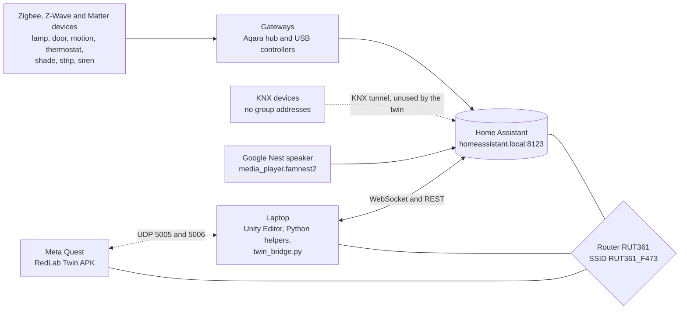
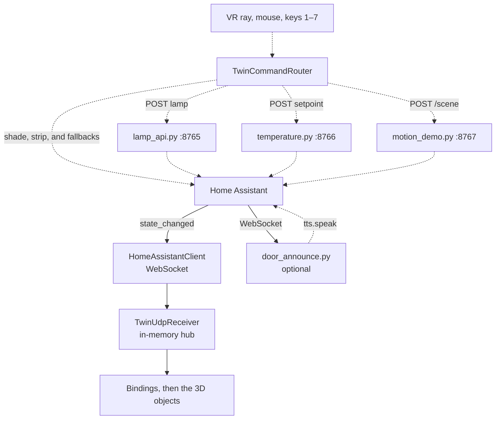
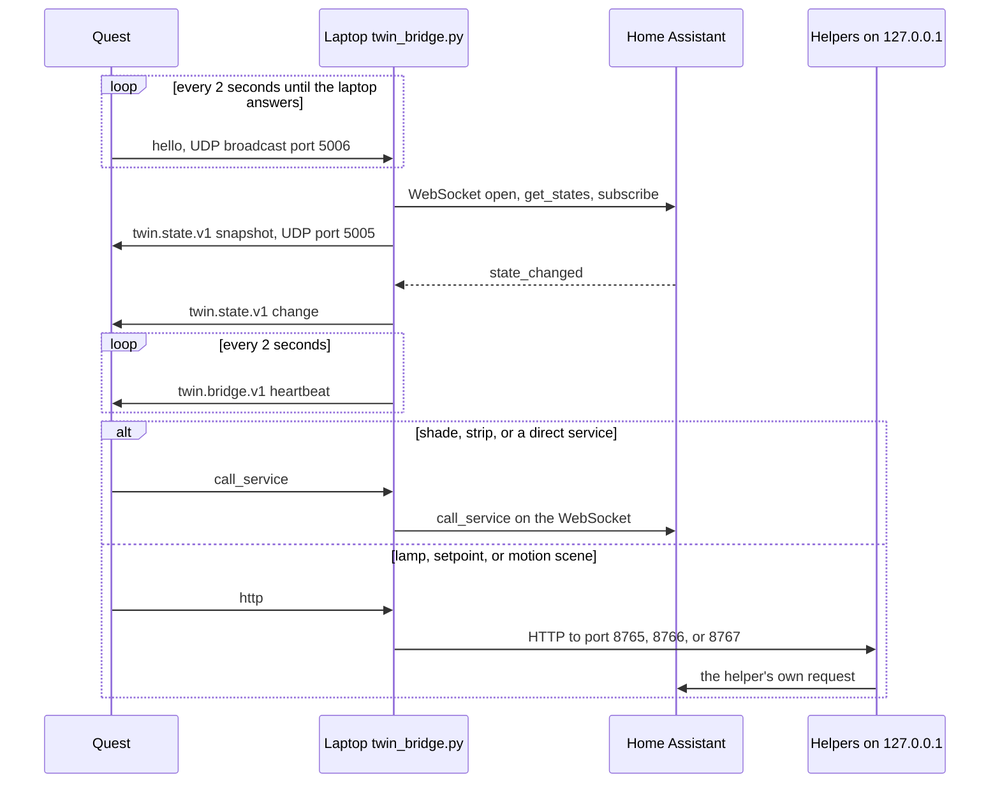

# RedLab Twin

Technical report · 16 October 2026  
XR application for the smart-home stand in room VK1 406, TalTech Virumaa College  
Source code: repository `RedTeam-BIP-2026`, branch `main`

## 1. Objective

The stand in VK1 406 is a real set of lamps, sensors, a roller shade, a thermostat, a siren, and a speaker. They already report to Home Assistant. The problem is to see that room in XR and to operate the same devices from inside the model, without a second control protocol and without pretending a command succeeded before the device answers.

RedLab Twin is one Unity scene, `Assets/Scenes/IvarLab.unity`. The scene name comes from an earlier reference model of the IVAR laboratory. The room that was scanned and built is VK1 406: about 5.81 m by 2.75 m, ceiling 2.91 m. Home Assistant is the only link to the hardware. The application reads states over its WebSocket API and sends commands over its REST API, sometimes through a small Python program on the PC. KNX equipment is mounted in the room, but this application does not send KNX telegrams. The group addresses on the stand were not set up, so each device is used through the integration Home Assistant already has for it: Matter, Zigbee, or Z-Wave.

The application is built in Unity 2022.3.62f3 with the XR Interaction Toolkit 3.5.0 and OpenXR 1.17.1.

## 2. Devices and software

The PC that runs the scene must be on the lab router, SSID `RUT361_F473`. Home Assistant is at `http://homeassistant.local:8123` on that network. It is not reachable from eduroam. The PC needs Unity 2022.3.62f3, Python 3, and the `websockets` package. Blender must be installed for Unity to import the room file `Assets/Models/ivar-lab-taltech.blend`. The device models that are FBX files import without Blender.

| Device | Home Assistant entity | What changes in the scene |
|---|---|---|
| Aqara Dimmer Switch H2, Matter | `light.aqara_dimmer_switch_h2_2` | Pendant lamp brightness, and the LED on the wall switch |
| Aqara Door and Window Sensor T1, Zigbee | `binary_sensor.aqara_door_and_window_sensor_t1_door` | Door leaf. The model has no moving window sash, so this sensor drives the door. |
| Aqara Motion Sensor P1 | `binary_sensor.motion_sensor` | Colour of the detection cone and the sensor LED |
| Aqara floor-heating thermostat | `sensor.aqara_floor_heating_thermostat_temperature` | Measured °C on the thermostat screen. This value is read-only. |
| Same thermostat, setpoint | `climate.aqara_floor_heating_thermostat` | The + and − buttons write this target. Allowed range 5–35 °C. |
| Aqara Roller Shade Driver E1 | `cover.aqara_roller_shade_driver_e1` | Shade fabric. A full travel takes 30 seconds, the same as the motor. |
| Fibaro RGBW Controller 2, Z-Wave | `light.rgbw_controller_2` | Colour of the LED strip |
| frient A/S SMSZB-120 Siren | `siren.frient_a_s_smszb_120_siren` | Warning beacon flashes while the siren entity is on |
| Google Nest speaker | `media_player.famnest2` | Jazz during the motion scene. Spoken “Door is open” from the door script. |

The shipped application is named RedLab Twin. The Android package is `com.tredlab.redlabtwin`, version 0.2.1, Android version code 10, minimum SDK 32, target SDK 34. Input uses Unity’s Input System package. The Quest build entry point is the menu **RedLab > Build Quest APK** (`Assets/Editor/RedLabQuestBuild.cs`). The release signing key is stored outside the repository.

## 3. System architecture

The twin talks only to Home Assistant. Home Assistant talks to the stand. Read the first figure from the devices on the left to the headset on the right. A solid line is a link the twin uses. A dotted line is present and unused.



Figure 1. The twin reaches every device through Home Assistant. KNX hardware is on the stand and is not a data path. In the Editor the laptop speaks to Home Assistant directly. A standalone headset speaks only to `twin_bridge.py` on the laptop. Both the laptop and the headset join `RUT361_F473`. Home Assistant is reached by the name `homeassistant.local`. The address `192.168.15.249` does not answer.

### Editor and PC

Figure 2 is the path when the scene runs in the Unity Editor or as a PC build on the same computer as the Python programs. Solid arrows carry device states. Dashed arrows carry presses.



Figure 2. States arrive on the WebSocket. Presses leave through the local programs or a Home Assistant service call. `door_announce.py` is optional and is not started by Play. `ha_twin_logger.py --udp 127.0.0.1:5005` can also feed the hub. Play mode does not need it, so it is left off this figure.

### Standalone headset

Figure 3 is the sequence when the APK runs on the Quest. The headset holds no Home Assistant token. `scripts/twin_bridge.py` on the laptop holds the token, keeps the WebSocket open, and starts the three helper programs. The headset finds that laptop by UDP broadcast. No address is typed on the headset.



Figure 3. The Quest announces itself on UDP port 5006. The bridge returns states to the headset’s UDP port 5005 and carries each press back to Home Assistant or to a helper on the laptop. The bridge also tries `192.168.137.1`, the address of a Windows mobile hotspot, beside the broadcast. A headset that stops sending hello is forgotten after 15 seconds. In the Editor this bridge client stays off, because the Editor uses Figure 2.

### How a state reaches the model

Take the door as the example. The same steps apply to every row in the table above.

1. The Aqara sensor reports open or closed to Home Assistant.
2. `HomeAssistantClient` is already connected to `ws://<host>:8123/api/websocket`. It has authenticated with a long-lived token, requested `get_states`, and subscribed to `state_changed`.
3. The client keeps the message only if the entity is one of the bindings in the scene, or the speaker. It turns the JSON into one `twin.state.v1` message: entity id, state, and, when present, brightness, colour, shade position, or thermostat target.
4. On the Unity main thread that message is passed to `TwinUdpReceiver`. The name is historical. For the normal path this object is an in-memory hub. It does not require a UDP packet.
5. The binding whose entity id matches updates the object. The door hinge rotates. A lamp enables its light. The shade sets its blend-shape target and spends 30 seconds travelling.

The token is entered in **IVAR > Home Assistant Settings** and stored on that computer, outside the project. It can also be supplied as the environment variable `HA_TOKEN`. If the socket drops, the client tries again every 3 seconds.

### How a press reaches the stand

A controller ray (grip or trigger), a mouse click in the Game view, or a number key calls `TwinCommandRouter`.

The router looks at one flag: is the WebSocket status **connected**? If it is not, the press does not move the model. The scene is set to real sensors only, so the local toggle is discarded before it is applied. The console logs `[Twin] ignored simulated … (real sensors only)`, and the status panel says **Presses do nothing — Home Assistant not connected**. The stand does not move. “Connecting…” is not “connected”. The menu item **Save + Test** is a separate HTTP check. A successful test does not open the Play-mode socket. The address to use is `http://homeassistant.local:8123`, and it answers only on the lab router. The numeric address `http://192.168.15.249:8123` does not.

If the status is connected, the router sends the command and then does nothing to the model. The model updates only when step 5 above delivers the new state. What the user sees is what Home Assistant reported, not what the button hoped for.

| Press | Request | If that program is not running |
|---|---|---|
| Motion sensor | `POST http://127.0.0.1:8767/scene` | Ignored. The stand is unchanged. |
| Roller shade | Home Assistant `cover.open_cover` or `close_cover` | No second path |
| Lamp | `POST http://127.0.0.1:8765/devices/lamp/set` | Unity calls `light.turn_on` or `turn_off` itself |
| LED strip | Home Assistant `light.turn_on` or `turn_off` | No second path |
| Thermostat + or − | `POST http://127.0.0.1:8766/devices/temperature/set` | Unity calls `climate.set_temperature` itself |
| Door, measured temperature, siren | No command. These report state. | — |

In the Editor, UDP port 5005 is an optional extra input. `scripts/ha_twin_logger.py --udp 127.0.0.1:5005` can push copies of states into the same hub. Home Assistant never sends UDP. The panel line **Waiting for Home Assistant on UDP :5005** means the hub is empty. It does not mean the WebSocket is waiting for that port. On a standalone headset the same port is the return path in Figure 3: the laptop bridge sends states there.

## 4. Use cases

These were run against the live stand from the Unity Editor on 14 October 2026, on the lab network.

**Lamp.** A press calls `use_case_1/lamp_api.py`. The phrasebook selects `light.aqara_dimmer_switch_h2_2`. The script sends `light.turn_on` or `light.turn_off`. Brightness is an integer from 0 to 255 on the same call. The pendant and the switch LED follow the state Home Assistant returns. On 14 October a VR press turned the physical lamp on, and changing the physical lamp updated the model.

**Door.** The Aqara T1 contact swings the door leaf by about 98 degrees. `scripts/ha_twin_logger.py` can write the same events to a JSONL file and forward them by UDP. A Z-Wave contact on the stand did not answer, so the scene uses the Zigbee sensor. The logger recorded live open and close events on 12 October. The model followed the door on 14 October, about 1–2 seconds behind the sensor.

**Temperature and alarm.** The screen shows the measured temperature. The + and − buttons write the climate setpoint through `use_case_3/temperature.py`, inside 5–35 °C. Every 5 seconds the script reads Home Assistant. The alarm is on when the measured temperature is above 25 °C, or when the setpoint itself is above 25 °C. While it is on, the script turns the frient siren on, turns the dimmer off, and sets the RGB strip to solid red. When the alarm ends, the siren goes off and those lights return to the state they had before. The beacon in the model flashes from the siren state. The measured temperature cannot be written. On 14 October the “−” button moved the real setpoint from 33.0 °C to 32.5 °C. The temperature on the screen follows the physical sensor. Warming that sensor by blowing on it raises the reading above 25 °C, and the frient siren on the stand turns on.

**Motion, shade, strip, and music.** `scripts/motion_demo.py` watches Home Assistant and does not edit its configuration. Motion on closes the shade. After 45 seconds without motion the script opens it. The wait is longer than the motor’s 30-second travel, so the shade can finish closing before it is told to open. A closed shade turns the strip red and plays Radio Swiss Jazz on the Nest speaker. An open or moving shade turns the strip green and stops the music. Pressing the motion sensor in VR posts to port 8767, which runs this sequence. Stopping the script with Ctrl+C restores the strip and the shade. On 14 October a VR shade press closed the real shade, and the motion scene ran with the strip red and the speaker playing. A local copy of this sequence in the scene still waits 10 seconds. Real sensors only is on, so that copy is not applied.

**Door announcement.** `scripts/door_announce.py` watches the same door sensor. Each time it opens, Home Assistant speaks “Door is open” on the Nest speaker, at most once every 10 seconds. In the scene, a label and a recorded clip play as well. This speech path was not recorded as its own live test, separate from the door sensor test.

In the Editor the number keys are 1 door, 2 motion, 3 thermostat, 4 lamp, 5 beacon, 6 shade, 7 strip. The headset has no keyboard.

## 5. Running the application

1. Join `RUT361_F473`. Open `http://homeassistant.local:8123` in a browser and confirm the page loads.
2. Open the Unity project in 2022.3.62f3 and load `Assets/Scenes/IvarLab.unity`. If the object **IVAR Lab** shows as a missing prefab, install Blender and reimport `Assets/Models/ivar-lab-taltech.blend`.
3. Open **IVAR > Home Assistant Settings**, paste a long-lived access token, and choose **Save + Test**. The URL stays `http://homeassistant.local:8123`. The report must say the connection succeeded and list the entities in the scene. `http://192.168.15.249:8123` does not reach Home Assistant.
4. Copy `use_case_1/.env.example` to `use_case_1/.env`. Set `HA_URL` and `HA_TOKEN` to the same values. The temperature program reads this file.
5. From the repository root, start the three programs and leave the terminals open:

```text
python use_case_1/lamp_api.py serve
python use_case_3/temperature.py serve
python scripts/motion_demo.py --url http://homeassistant.local:8123 --http 8767
```

On Windows, `python -X utf8` avoids console errors on non-ASCII names. Optional extras are `python scripts/door_announce.py --url <HA_URL>` and `python scripts/ha_twin_logger.py --url <HA_URL> --udp 127.0.0.1:5005`.

6. Press Play. The panel must show **Home Assistant: connected** and **Presses → real stand**, and the three helpers as on. A console line `[Twin] ignored simulated` means the WebSocket is not connected and the stand was not commanded.
7. Operate a device with the controller ray, with the mouse in the Game view, or with keys 1–7.

The Unity project in the repository is the application. Opening it and pressing Play is how it runs on a computer. A headset connected with Link or Air Link shows that same Play session. The game stays on the computer, so the three Python programs on `127.0.0.1` still apply. Nobody rebuilds the scene, the XR rig, or a store listing to do this.

A package that runs on the headset by itself is a separate job, done once per release. **RedLab > Build Quest APK (release)** needs Unity’s Android Build Support and a signing key kept outside the repository. Close the Project Settings window before that build, otherwise Unity clears the signing passwords mid-build. People who only install an existing headset build do not run this menu.

## 6. Results

`main` contains the scanned room, the device models, and one XR scene connected to the stand through Home Assistant. On 14 October the lamp, the door, the motion scene, and the thermostat setpoint were exercised on the live hardware from VR. A command in the model changes the device, and the model then shows the state Home Assistant reports back.

The siren and the temperature reading were confirmed on the stand by warming the physical sensor until the measured value passed 25 °C. The spoken door announcement was not recorded as its own live test. The scene runs in the Editor on the lab network. The Quest package name, version, and build script are in the project. Frame rate and latency on a headset were not measured.

The project uses Unity 2022.3.62f3 rather than 2022.3.76f1, and the XR Interaction Toolkit rather than VRTK. Devices stay where the scan placed them. They are not moved at runtime.

## 7. Further development

The alarm can be acknowledged. Today the siren stays on for as long as the measured temperature or the setpoint is above 25 °C. A person in the room needs a way to silence it while the reading is still high, so the sound means “this has been noticed” and then stops.

Each device needs its own state label, placed next to the object. A change such as on, off, opening, or a new temperature should be readable there, at the component, as well as on the status panel.

The helper programs should be able to address several Home Assistant devices in one response. A real condition in the room, such as heat, an open door, or motion, can then drive a coordinated set of actions across lights, shade, climate, and the siren, rather than one program owning one device.
